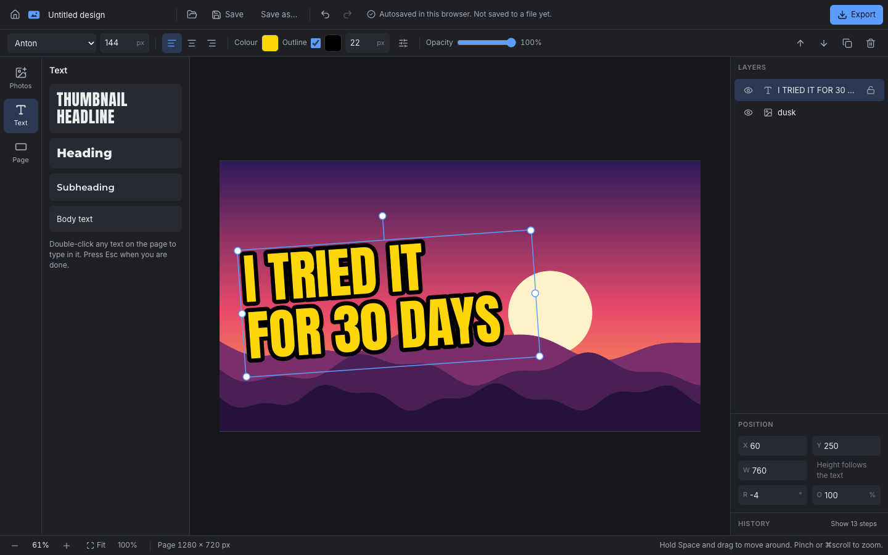
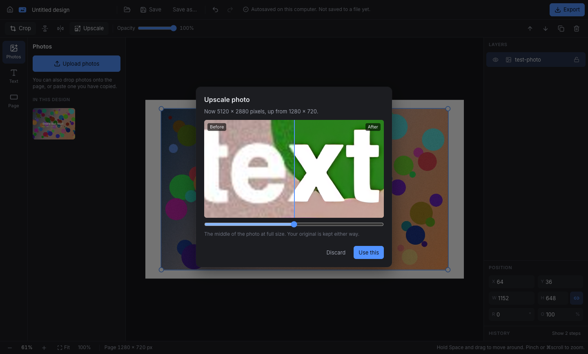

# FVS Design Editor

An open-source, local-first design editor for photo editing and YouTube thumbnails. It runs in the browser and as a desktop app, with no account and no server.



> **Status: first working slice.** You can add photos and text, move, resize, rotate and crop them, undo and redo, save a portable project file, reopen it, and export PNG or JPG at exact pixel sizes. Much of the [project brief](docs/PROJECT_BRIEF.md) is still to come; see [what is not built yet](docs/architecture.md#not-built-yet).

## What works today

- **Photos:** upload, drop or paste. Originals are never altered; cropping only changes which part is shown, so it can always be changed back.
- **Upscale:** make a larger, sharper copy of a low-resolution photo so it holds up at 4K. It is worked out on your own computer, shown beside the original before you accept it, and can be turned off again. See [Upscaling photos](#upscaling-photos).
- **Text:** type directly on the page, with font, size, weight, colour, outline, alignment and spacing.
- **Fonts:** five are built in, so text works offline. Beyond those, a searchable font menu offers about 1,960 Google Fonts families (each downloaded the first time you use it, then kept on your computer), the fonts installed on your computer, and font files you add. See [Fonts](#fonts).
- **Layers:** show, hide, lock, rename and reorder, with exact position, size and rotation.
- **Undo:** one step per action, however long the drag or typing session, plus a history list.
- **Saving:** continuous autosave with a visible status, a recent-designs screen, and a project file (`.fvsdesign`) that contains the design and every original image.
- **Export:** PNG (with transparency) or JPG (with quality and a file-size limit) at any size up to 8192 pixels, identical whatever the zoom level or screen.

## Fonts

| Where a font comes from | What happens | Does it travel inside the project file? |
|---|---|---|
| Built in (Inter, Montserrat, Poppins, Anton, Bebas Neue) | Always available | Not needed |
| Google Fonts | Downloaded from Google the first time you pick it, then works offline | Yes, always. These fonts are openly licensed. |
| Installed on your computer | Used where it is. Nothing is copied or uploaded. | Only if the font allows it and you tick the box in the font menu |
| A font file you add (`.ttf`, `.otf`, `.woff`) | Kept on your computer | Only if the font allows it and you tick the box in the font menu |

If a design is opened on a computer that does not have one of its fonts, the editor says which font is missing and offers the quickest fix. It never swaps in another font silently.

Listing installed fonts works in Chrome, Edge and the desktop app, when you ask for it under "This computer" in the font menu. Firefox and Safari cannot list them; add the font file instead. The first listing can take up to a minute on a computer with many fonts, and the desktop app waits for it to finish before it can quit.

The only time the editor contacts another server is when you pick a Google font (or turn on previews of Google fonts): it downloads from `fonts.googleapis.com` and `fonts.gstatic.com`. The list of Google families ships with the app; refresh it with `pnpm fonts:catalogue`. Licences and sources are in [docs/research/fonts.md](docs/research/fonts.md).

## Upscaling photos



Select a photo and press **Upscale**. The button stands out when the photo is stretched beyond its own resolution on the page, and the export dialog warns about the same thing.

- You choose 2 times or 4 times larger; the editor suggests the one that keeps the photo sharp at 4K.
- The first time, a 4.9 MB helper (the Real-ESRGAN "general x4 v3" model, BSD-3-Clause) is downloaded from `huggingface.co`, checked against a known fingerprint, and kept on your computer. After that Upscale works with no internet. The file is not part of this repository or the app.
- Nothing is uploaded. The work runs on your graphics card where the browser supports it, and on the processor otherwise.
- You see before and after side by side, then keep or discard the result. Keeping it is one undo step. Your original stays in the project, and "Turn off and use the original" brings it back exactly.
- The enlarged copy is saved inside the project file, so reopening never recomputes it.
- If the helper cannot be downloaded or cannot run, a plain resize is offered instead, and it is labelled as adding no new detail.

How long it takes, measured on one Apple M1 Pro laptop for a 1280 × 720 photo made 4 times larger: about 5.5 seconds on the graphics card, and about 2.5 minutes on the processor alone. Slower computers will take longer. Models considered, licences and the full measurements are in [docs/research/upscaling.md](docs/research/upscaling.md).

## Run it

You need Node.js 22 and pnpm.

```bash
pnpm install
```

Start the web version, then open the address it prints:

```bash
pnpm dev
```

Start the desktop app (the first run downloads Electron):

```bash
pnpm desktop
```

## Tests

Unit tests for the document model, undo history, storage, fonts, upscaling and project files:

```bash
pnpm test
```

End-to-end tests in a real browser and in the desktop app. They run the whole flow (import, edit, crop, undo, save, reopen, export) and check that the exported image is byte-for-byte the same before saving and after reopening. The font tests never contact Google: they answer its two hosts with openly licensed fonts from `node_modules`. One of them lists the fonts installed on the machine, which can take up to a minute. The upscale tests never download the real model: they use a 316-byte stand-in model (`tests/fixtures/nearest-x4-stub.onnx`) that the real runtime runs in the real worker.

```bash
pnpm test:e2e
```

That uses Playwright's own Chromium, installed with `pnpm exec playwright install chromium`. To use an installed Google Chrome instead, set `PW_CHANNEL=chrome`. The desktop test opens an app window for a few seconds.

## Continuous integration

Every pull request, and every push to `main`, is checked automatically on a Linux machine by GitHub Actions ([.github/workflows/ci.yml](.github/workflows/ci.yml)). It installs the dependencies exactly as the lockfile lists them, then runs the typecheck, the unit tests, and the end-to-end tests in Chromium and in the desktop app.

- A green tick on a pull request means all of that passed on Linux. A red cross links to the step that failed.
- When an end-to-end test fails, its traces and screenshots are kept for 7 days under "Artifacts" on the run's page.
- The workflow only reads the repository. It uses no secrets and publishes nothing, and the tests answer Google Fonts and Hugging Face themselves, so a run does not depend on either service.
- pnpm refuses to install a package that was published less than 24 hours ago. If a dependency is updated to a version released that same day, the "Install dependencies" step fails until the package is a day old; run the check again then.

macOS and Windows are not checked automatically.

## How it is built

React 19, TypeScript, Vite, Tailwind CSS and Zustand, with Fabric.js 7 drawing the canvas and Electron as the desktop shell. The design is stored in the editor's own versioned document format; Fabric only renders it. The reasoning, the module layout and the file format are in [docs/architecture.md](docs/architecture.md), and the survey of existing editors that led to building from scratch is in [docs/research/open-source-bases.md](docs/research/open-source-bases.md).

## Cloud environment (Claude Code)

Cloud sessions use an environment configured at [claude.ai/code](https://claude.ai/code). Its settings are recorded here so anyone can reproduce them.

**Setup script:** the contents of [scripts/cloud-setup.sh](scripts/cloud-setup.sh). Keep the environment's copy and this file the same.

**Network access:** Limited, with "Allow package managers" checked, plus these allowed domains:

```text
cdn.playwright.dev
playwright.download.prss.microsoft.com
huggingface.co
*.huggingface.co
*.hf.co
```

**Environment variables:**

```text
DESKTOP_SHELL=auto
PLAYWRIGHT_BROWSERS_PATH=/opt/pw-browsers
ELECTRON_DISABLE_SANDBOX=1
```

`DESKTOP_SHELL` accepts `auto`, `electron`, `tauri`, `both` or `none` and controls which desktop build dependencies the setup script installs. The project uses Electron, so `auto` or `electron` is right.

The font hosts `fonts.googleapis.com` and `fonts.gstatic.com` are on the default allowed list, so downloading Google fonts works in cloud sessions without adding anything. The Upscale model comes from `huggingface.co` and `*.hf.co`, which are in the list above.

**Secrets:** none. The app has no backend, so no keys are needed. Do not put credentials in environment variables; everyone who uses the environment can read them.

The setup script result is cached for about a week, so [scripts/session-start.sh](scripts/session-start.sh) also runs `pnpm install` and fetches Electron at the start of each cloud session. It does nothing on a local machine.

Cloud sessions run Linux, so they can check the web app and a Linux desktop build. macOS and Windows desktop builds need a local machine or CI.

## Contributing

Issues and pull requests are welcome. The project is early, so please open an issue before starting a large change.

## License

[MIT](LICENSE). Third-party work the app ships or downloads is listed in [THIRD_PARTY_NOTICES.md](THIRD_PARTY_NOTICES.md).
